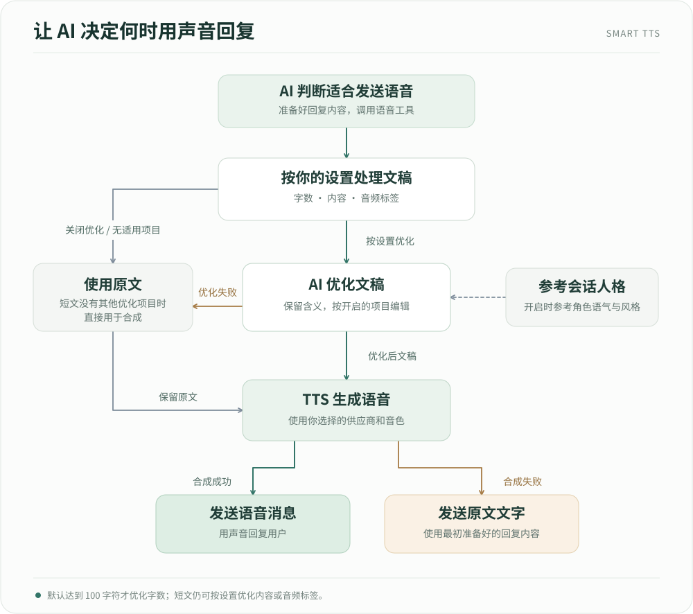

# Smart TTS

让 AstrBot 的 AI 根据对话内容，自主决定什么时候发送语音。适合问候、安慰、祝福和简短闲聊，也可以直接要求它用语音回复。

插件使用你在 AstrBot 中配置的 TTS 供应商和音色，并可在合成前调整文稿长度、改善朗读表达、添加声音标签。

## 安装与开始使用

使用前请准备：

- AstrBot **4.28.0 或更新的 4.x 版本**，使用内置 Agent 执行器。
- 支持工具调用的对话 LLM。
- 已配置并启用、能够正常合成音频的 TTS 供应商。
- 支持接收语音或音频消息的平台。

1. 在 AstrBot WebUI 的插件管理中，通过[仓库地址](https://github.com/SihenZhang/astrbot_plugin_smart_tts)安装 Smart TTS。
2. 打开插件配置，在 **TTS 供应商**中选择要使用的供应商。模型和音色沿用该供应商的配置。
3. **文本优化 LLM 供应商**可以留空，默认使用当前会话的对话 LLM。
4. 在当前人格的工具设置中启用 `send_voice_message`。
5. 关闭当前会话所用 AstrBot 配置的自动 TTS（`provider_tts_settings.enable` 设为 `false`），由本插件控制语音发送时机。TTS 供应商自身保持启用。

然后发送：

> 用语音和我说声晚安。

AI 会选择是否调用语音工具。你也可以在人格提示中加入偏好，例如：“适合简短闲聊时可以用语音；用户要求语音时直接调用语音工具。”

## 默认效果

- **少于 100 字符**：直接将 AI 准备的回复合成为语音。
- **达到或超过 100 字符**：先让 LLM 尽量精简到 100 字以内，再合成语音。
- **内容优化和音频标签优化默认关闭**，可按需开启。
- **人格风格参考默认开启**，在优化文稿时帮助保留角色的语气、称呼和表达习惯。

优化失败时会使用原文继续合成；语音合成失败时会发送原文文字。

## 按需配置

在插件配置中调整以下选项即可，通常先保持默认值试用。相关选项会随开关和模式选择显示，隐藏后仍保留已填写的值。

| 配置名称 | 默认值 | 用途 |
| --- | --- | --- |
| TTS 供应商 | 必选 | 决定语音使用的服务、模型和音色。 |
| 文本优化 LLM 供应商 | 留空 | 留空时跟随当前会话，也可选择专用模型。 |
| 启用文本优化 | 开启 | 总开关；关闭后直接合成原文。 |
| 启用字数优化 | 开启 | 回复达到字数目标时，精简重复和次要表达。 |
| 字数上限目标 | 100 | 可设为 1–500，同时作为触发阈值和精简目标。 |
| 启用内容优化 | 关闭 | 调整措辞、句式和口语表达，使文稿更适合朗读。 |
| 启用音频标签优化 | 关闭 | 添加模型支持的情绪、发声或停顿提示。 |
| 音频标签模式 | `auto` | 根据当前 TTS 供应商及模型选择适用规则。 |
| 自定义音频标签提示词 | 留空 | 在 `custom` 模式下，用普通文字描述标签格式、使用情境和限制。 |
| 注入当前会话人格 | 开启 | 优化时参考当前人格的表达风格。 |

字数、内容和音频标签优化可自由组合。开启内容优化或适用的音频标签优化后，短文也会执行相应优化。人格风格参考随文稿优化生效。

音频标签建议先使用 `auto`。无法识别适用规则时，会跳过标签优化，其他已启用的优化仍按各自条件处理。

使用代理服务或自定义模型名称时，可以手动选择与实际模型匹配的规则。语音合成仍使用原来配置的 TTS 模型；标签效果取决于模型和音色。

需要自己的标签规则时，在插件配置中打开 **启用文本优化** 和 **启用音频标签优化**，将 **音频标签模式** 设为 `custom`，再填写 **自定义音频标签提示词**。请按实际 TTS 模型支持的标签编写纯文本要求。提示词留空或只有空白时，会跳过标签优化，其他已启用的优化仍按各自条件处理。

## 常见问题

### 为什么收到的是文字？

AI 会结合语境选择回复方式。可以明确要求“请用语音回复”，并确认对话模型支持工具调用、当前人格已启用 `send_voice_message`。

如果 TTS 供应商不可用、合成出错或合成超时，插件会发送原文文字。请先检查所选 TTS 是否启用、余额及模型配置是否正常，再查看 AstrBot 日志中的失败阶段。

### 为什么短文没有缩短？长文一定会控制在目标内吗？

字数优化只在原文达到或超过目标时触发。仅开启字数优化、目标为 100 时，99 字符直接合成，100 字符开始精简；标点和空白也计入字符数。目标可设为 1–500。

LLM 会尽量按目标压缩，并保留核心含义，实际长度由生成结果决定。插件会保留完整文稿；优化失败时使用的原文也可能超过目标。

### 为什么电话号码、邮编、邮箱或一些短语读错了？

TTS 可能把连续数字读成数量，或误读邮箱符号、缩写等复杂内容。在插件配置中打开 **启用文本优化** 和 **启用内容优化**，让 LLM 在合成前将这些内容整理成适合朗读的表达，有助于改善读音。实际效果仍取决于所用模型和音色。

### 为什么声音标签被读出来了？

通常是所选规则与 TTS 模型的能力不匹配。先尝试 `auto`；手动选择时，确认实际模型支持对应规则。此外还可关闭音频标签优化，单独确认基础语音合成是否正常。

### 为什么生成语音比较慢，或出现超时？

开启优化后，会先等待 LLM 整理文稿，再进行语音合成和发送。可使用更快的优化 LLM、缩短回复，或关闭暂时不需要的优化项目。

以下选项控制等待时间和同时处理的请求数：

| 配置名称 | 默认值 | 可设置范围 |
| --- | --- | --- |
| 文本优化超时（秒） | 20 | 1–120 |
| 语音合成超时（秒） | 20 | 1–120 |
| 消息发送超时（秒） | 10 | 1–60 |
| 同时处理的语音请求数 | 2 | 1–8 |

三个超时默认合计 50 秒，调整后应小于 AstrBot 的工具调用超时，并留出余量。请求过多时可能提示繁忙。发送超时也可能发生在平台已经收到消息之后，请先确认聊天中是否已出现语音。

### 为什么语音前还有一段文字，或不同平台显示不同？

部分对话模型会在调用工具前先说一句话，可以在人格提示中补充：“决定使用语音时直接调用工具，无需先说明。”

语音的格式、显示方式和播放效果取决于 TTS 供应商及消息平台，请在自己的部署环境中试用确认。
